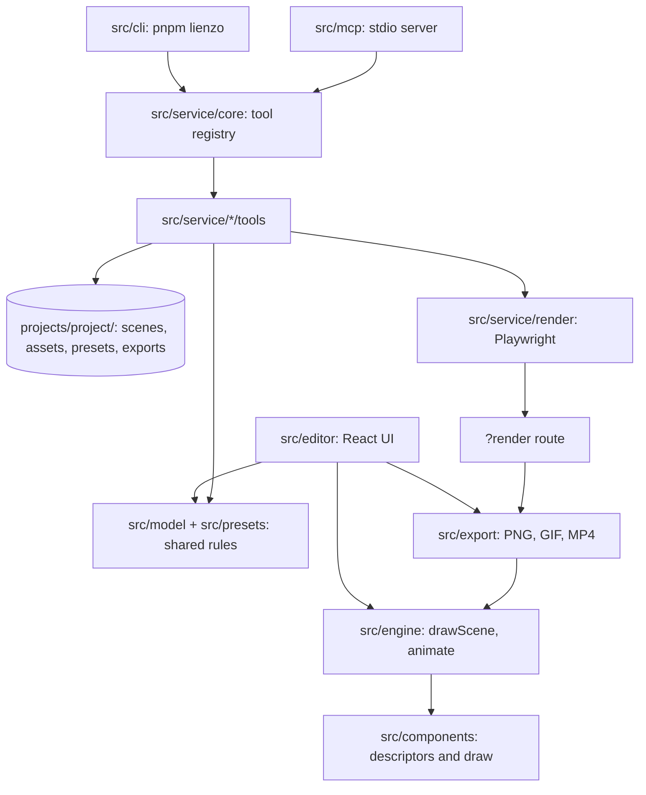

# Architecture Blueprint

This document defines the system architecture, directory boundaries, system topology, and technical stack of Lienzo. AI agents must consult it before modifying system structure or introducing new components. Coding standards live in [ENGINEERING.md](./ENGINEERING.md), test rules in [TESTING.md](./TESTING.md), and the history of changed decisions in [CHANGES.md](./CHANGES.md).

---

## 🏛️ System Overview & Boundaries

### 1. Overview
Lienzo is a single local web app (React + Vite) at the repository root: a free-form canvas editor for animated social media posts. A scene is plain JSON drawn on an HTML canvas by one pure function, `drawScene(ctx, scene, t)`, which the editor preview and every export call. Everything outside the editor (scenes, presets, assets, exports) is done through tools defined once in a registry; the CLI (`pnpm lienzo`) and the MCP server are thin adapters over it. Rendering outside the editor loads the app in headless Chromium through Playwright. There is no database, no hosting and no accounts (A2, A7).

### 2. Tech Stack & Dependencies
- **Runtime & Language:** TypeScript on Node.js 24 LTS, pinned in `.nvmrc` (A8).
- **Frameworks & Libraries:** React 19 + Vite for the editor (A9); Zod for schemas; `@modelcontextprotocol/sdk` over stdio for the MCP server and `tsx` for the CLI (A22); three.js for the 3D element (A25); Playwright (`playwright-core`) for headless rendering (A21); lucide / lucide-react for icons (A11); `@fontsource/*` for bundled fonts (A12).
- **Export:** gifenc for GIF; Mediabunny on WebCodecs for MP4/WebM; `OffscreenCanvas.convertToBlob` for PNG (A10).
- **Storage & Infrastructure:** none beyond the file system. Built-in presets in `presets/`; each project workspace in `projects/<project>/`; the current scene is also autosaved to `localStorage` (A7).

### 3. Layer Boundaries & Directory Map

```
src/model/       scene and background types, size presets, fonts; Zod schemas (schema.ts,
                 element-schema.ts generated from the descriptors)
src/animations/  the animation registry, one file per family (entrances, attention, emphasis,
                 text): pure functions of progress; exits replay entrances backwards
src/engine/      drawScene, animate, keyframe tracks, painting helpers, animation state,
                 geometry, particle field; audio/ = audio tracks and timing; subtitles/ =
                 cue layout and word windows; path/ = free-path geometry
src/components/  index.ts = the registry; descriptor.ts = the descriptor type; fields/ = field
                 builders and shared field groups (box, fill, stroke, glow, shadow, label, anim);
                 <kind>/descriptor.ts + <kind>/draw.ts per element kind (the kinds are the
                 ones registered in index.ts)
src/editor/      React UI: app shell, stage, library, background library, animation library
                 (anim-library.tsx), inspector (the
                 element inspector is generated: layout.ts + field-editor.tsx; keyframe
                 buttons in keyframe-controls.tsx; timeline/ = the keyframe tracks panel;
                 sidebar/ = the project tabs: Escenas, assets, presets; brand/ = brand guide
                 managers; dialogs/ = modal dialogs (TTS, brand); footer/ = editor footer;
                 widgets/ = custom field widgets; joint/ = joint mode)
src/export/      PNG / GIF / MP4
src/traits/      reusable style pieces, one file per trait
src/presets/     recipe resolver, recipe diff, JSON store (server side: json-store.ts; client:
                 store.ts), categories and filter, JSON import/export helpers,
                 animation presets (anim-presets.ts: capture, apply, stagger, expand on load)
src/service/     one folder per functionality, each with its logic and tests and a tools/
                 folder with one file per tool and its tests (007, 082): scenes, elements,
                 shots (shots and keyframes), assets, fonts, presets (and animations),
                 projects, speech (TTS adapters and proxy), render (headless renderer, 010,
                 exports), compact (compact scene expansion, 011), layout; core = registry,
                 ctx, Node store, verdict, project scope; contract = the tests that cross
                 functionalities; tools/index.ts = the one TOOLS list
src/cli/         `pnpm lienzo`: args (flags/--json → input), help, main (008); build.ts
                 bundles dist/cli.js
src/mcp/         `pnpm lienzo mcp`: the stdio MCP server over the registry (009)
src/test/        golden render tests, fixtures and test helpers
src/types/       type declarations for packages that ship none
docs/            reference docs (components.md: every component kind)
presets/built-in/  built-in preset recipes (JSON); user presets sit next to it in presets/
presets/animations/  animation presets (JSON)
projects/        project workspaces (e.g. projects/mi-proyecto/ containing scenes/, assets/, presets/, exports/)
```

### 4. Topology & Data Flow Diagram


---

## 🔒 Structural Invariants & Boundaries

1. **One drawing path:** the preview and every export call `drawScene(ctx, scene, t)`; nothing else draws a scene (A3, A21, A25).
2. **Time only through `animate`:** components never read `t` to animate, and nothing draws with wall-clock time (A24, [ENGINEERING.md](./ENGINEERING.md)).
3. **Descriptors drive everything:** a component kind is one descriptor folder; its type, schema, defaults, inspector, compact format and tools are derived, never written by hand elsewhere (A5, A23).
4. **Thin adapters:** the CLI and the MCP server hold no logic; logic lives only in tools, one file per tool, one registry (A20).
5. **One rule, one place:** a rule both the editor and the tools apply is one pure function in `src/model/` (or `src/presets/` for slugs) that both call (A27).
6. **Project boundary:** every scene, asset, speech audio and export lives in `projects/<project>/`; every scene, asset and export tool takes a required `project`, there is no default project and no asset is borrowed across projects (A7).
7. **Plain-Node loadable:** code the descriptors import must load in plain Node: no Vite-only imports (`?url`, `?raw`, `import.meta.glob`); static files go in `public/`.
8. **Engineering Standards:** for coding conventions and design patterns consult [ENGINEERING.md](./ENGINEERING.md).

---

## 📌 Decisions (A1–A27)

IDs are stable and cited by specs: a replaced decision stays struck through with its replacement, and the reason lives in [CHANGES.md](./CHANGES.md).

These decisions come from the canvas prototype the user validated on 2026-10-07 ("that is exactly what I wanted").

### Container

- A1: A single web app built with React and Vite, at the repository root; no monorepo — why: one app, no other consumers; simplest structure that holds the editor.
- A2: Runs locally from a cloned repository with `pnpm dev`; no hosted deployment, no accounts, no authentication — why: single local user, zero cost.
- A3: Scenes are drawn on an HTML canvas with the Canvas 2D API by one pure function `drawScene(ctx, scene, t)`; the editor preview and every export call it — why: one drawing path means the preview equals the export, and frame-by-frame export is deterministic.
- A4: A scene is plain JSON (size, loop duration, fps, background, ordered element list) defined by TypeScript types in `src/model/` — why: JSON is what presets and scenes are stored as; no translation layer.
- A5: Each canvas component kind lives in its own folder `src/components/<kind>/` (its descriptor and its draw function, see A23); shared painting helpers (glow, shadow, gradients, animation state, `animate`) live in `src/engine/` — why: adding a component means adding a folder.
- A6: Animations are a function of time within one loop; looping animations use a whole number of cycles per loop so exported GIF and MP4 loops are seamless — why: validated in the prototype.
- A7: No database. Built-in presets and animation presets are JSON files in `presets/`; everything a post uses lives in a project workspace `projects/<project>/` (`project.json` with the brand guide and canvas defaults, `scenes/`, `assets/` named by content hash, `presets/`, `exports/`, `fonts/`), read and written through a small Vite dev-server middleware (`/api/projects`, `/api/presets`, `/api/animations`, `/api/fonts`) and by the tools; only `projects/mi-proyecto/` is versioned as the default template; the current scene is also autosaved to `localStorage` — why: files are easy to inspect, copy and version, and a project keeps its scenes and the files they use together, never borrowing another project's.

### Stack

- A8: TypeScript on Node.js 24 LTS; version pinned in `.nvmrc` — why: newest LTS.
- A9: React 19 + Vite for the editor UI — why: used by the validated prototype.
- A10: GIF export with gifenc; MP4 export with Mediabunny on WebCodecs (H.264, falling back to WebM/VP9 when the browser cannot encode H.264), Mediabunny at 1.61.6 or later; PNG through `OffscreenCanvas.convertToBlob` — why: all run in the browser with no server; gifenc MIT, Mediabunny MPL-2.0 used unmodified; 1.61.6 repairs the malformed AVC description Firefox emits on Windows (Bugzilla 2082867, mediabunny #559), which phones and WhatsApp cannot decode.
- A11: Icons from lucide-react (UI) and lucide (canvas icon component) — why: one icon set; ISC.
- A12: Fonts are bundled with `@fontsource/*` packages; user fonts are files on disk (git-ignored `fonts/` globally, `projects/<slug>/fonts/` per project) and the only network use is an explicit, user-triggered Google Fonts download saved to those folders — never loaded from a CDN at run time — why: works offline; the user chooses when a third-party service is used.

### Conventions

- A13: pnpm is the package manager — why: user's standing preference.
- A14: Biome for lint and format; Vitest for tests of the model, engine and service. Contracts, shared rules and every tool's failing inputs are tested completely: the rules in the writer matrix (`src/service/contract/`), the inputs from each tool's schema; implementation details and a micro-test per Zod field are not (SRP/KISS: no redundant tests, but no gap in a rule or a tool). Tests are named by behavior, never by spec or round, and live with the functionality they test; single files run while working — why: one tool each; fits Vite; specs 067–081 showed that minimal, case-by-case tests leave every new QA run finding a new case of an old rule (082).
- ~~A15: CI on GitHub Actions runs `pnpm lint`, `pnpm typecheck` and `pnpm test` on every push and pull request — why: free for public repositories.~~ retired 2026-10-24
- A16: UI text is Spanish; code, comments, docs and commit messages are English — why: user preference.
- A17: Conventional Commits — why: standard (https://www.conventionalcommits.org/en/v1.0.0/).
- A18: The repository is MIT and every runtime dependency must be MIT-compatible at zero cost — why: hard constraint.

### Presets

- A19: Reusable styling lives as traits in `src/traits/`, one file per trait; a preset is a JSON recipe (kind, traits with parameters, own values) resolved into a plain element when dropped — why: presets compose pieces instead of rebuilding elements, and scenes stay plain JSON (A4).

### Automation

- A20: Every operation on scenes and presets outside the editor is a tool defined once, one file per tool in the `tools/` folder of its functionality (`src/service/<feature>/tools/`, listed in `src/service/tools/index.ts`): a `snake_case` noun_verb name (`scene_export`), description, Zod input and output, `run(input, ctx)`; the CLI and the MCP server are thin adapters that expose every tool of the one registry and hold no logic — why: both stay identical, a new capability is one file, and MCP tool names allow only `[a-zA-Z0-9_-]`.
- A21: Rendering outside the editor loads the app in headless Chromium through Playwright, using the installed Chrome when present so MP4 can use H.264 — why: keeps A3 (preview = export) with no second drawing path.
- A22: The MCP server uses `@modelcontextprotocol/sdk` (MIT) over stdio; the CLI runs with `tsx` — why: the official SDK; no build step for a local tool.

### Components and time

- A23: Every component kind is one descriptor in `src/components/<kind>/` declaring its fields (type, range, label, inspector section), defaults, draw function and animatable properties; the scene schema, the inspector, keyframe targets, the compact format and the service tools are derived from the descriptors; shared field groups (box, fill, stroke, glow, shadow, label, anim) are reusable pieces descriptors compose — why: a new component or field is declared once and works everywhere.
- A24: Time is applied by one pure layer, `animate(el, t, scene)`, that resolves preset animations and keyframe tracks into a plain element plus its transform before any component draws; components never read `t` to animate — why: every component gets every kind of animation with no code of its own.
- A25: The 3D element renders with three.js into an offscreen WebGL canvas composited into the 2D canvas with `drawImage`, driven only by `t` — why: keeps `drawScene` the single drawing path (A3).
- A26: Animations can be saved as animation presets: JSON files in `presets/animations/` holding an `anim` and keyframe tracks with times relative to their start and movements relative to the element (positional fields are marked `relative` in their descriptors); applying one always copies it, and a scene may name a preset (`animPreset`) that is expanded into copied values when the scene loads, so `animate` never reads the library — why: the same reuse model as element presets (A19), without After Effects' known pitfalls (absolute positions, playhead-dependent timing, overwriting unrelated animation), and drawing stays pure (A24).

### Shared rules

- A27: A rule both the editor and the tools apply (shot timing, shot edits, scene defaults, slugs, element defaults) is one pure function in `src/model/` (or `src/presets/` for slugs) that both call; a tool or a component never re-implements it, and `src/service/tools/contract.test.ts` holds it with one case per writer — why: specs 071–074 patched one writer at a time and the same family of failures came back each QA round (075).

---

## 🧩 Implementation Notes (what exists today)

Where each decision lives in the code, grouped by area. A spec number in parentheses points to the retired spec that introduced it (`planning/specs/`).

- Single React 19 + Vite app at the repo root, TypeScript on Node 24 (A1, A8, A9)
- Everything is drawn with Canvas 2D by `drawScene(ctx, scene, t)`; preview = export (A3)
- Scene = plain JSON (A4); every component kind is one descriptor in `src/components/<kind>/`
  that declares its fields, defaults, inspector sections, draw function and animations; the
  element types, the Zod element schema, default elements, the inspector and the library's
  basic components are derived from the descriptors (A23)
- Time is applied only by `animate(el, t, scene)` (`src/engine/animate.ts`) before a component
  draws; components get the result as a transform (A24)
- Looping animations use whole cycles per loop (A6)
- Presets in `presets/`, and project workspaces in `projects/<project>/` containing `project.json`,
  `scenes/`, `assets/`, `presets/`, and `exports/`; no database (A7, spec 040)
- The default workspace template is `projects/mi-proyecto/`, which is the only project tracked in Git
- Reusable styling = traits in `src/traits/`; presets are JSON recipes of traits (A19)
- Export: gifenc (GIF), Mediabunny (MP4/WebM), canvas (PNG) (A10); Mediabunny and its AAC encoder are
  dynamic imports, loaded only by a video export (066)
- Icons: lucide-react / lucide (A11); the lucide set drawn on the canvas (`src/engine/icon-set.ts`) loads
  on demand through `iconSet` in `icon-shapes.ts` (066); on-demand imports use `lazyModule`
  (`src/engine/lazy-module.ts`); fonts: `@fontsource/*` (A12); user fonts are files in git-ignored `fonts/`
  (global) and `projects/<project>/fonts/`, named `Family-Weight.ext`, served at `/api/fonts`,
  loaded with `FontFace` by `src/engine/fonts.ts` in the editor and the `?render` route;
  Google Fonts only through `src/service/fonts/google-fonts.ts` (`font_install`) (A12, spec 045)
- pnpm only (A13); Biome + Vitest (A14); lint, typecheck and test run locally
- UI text in Spanish; code, comments and docs in English (A16)
- Conventional Commits (A17); MIT-compatible deps only (A18)
- Scenes and preset recipes are validated with Zod in `src/model/schema.ts` before any
  import is written
- Keyframes: `el.tracks` (optional) by field path or channel (`@rotate`, `@scale`); all
  evaluating and editing goes through `src/engine/tracks.ts`, applied by `animate` before
  the preset animation (spec 015)
- Image crop: non-destructive `crop` on image elements (fractions of the picture); trimming and
  cropping go through `alphaBounds`/`applyCrop` in `src/engine/image-trim.ts`, shared by the
  inspector, the stage crop mode and the `image_trim` tool (specs 048, 049)

- Element targets: tools resolve an `id` or `group/child` path at any depth; `element_add`
  takes a `parent` (spec 051)
- Tracks take `repeat: "loop" | "pingpong"` and `until`, evaluated in `src/engine/tracks.ts`
  (052); every element has `origin` (pivot, box fractions) and `opacity` (053); `text` takes
  a wrap width `w`, and Node-side text measurement uses real glyph metrics (054)
- Shots: `scene.shots` (cut windows, transitions, camera) and `el.shot` bindings; edited by
  `shot_set` (055). Symbols: `scene.symbols` drawn by the `use` kind with `overrides` (056)
- Tool/editor parity (062): every editor save has a tool (`scene_update` with JSON Merge
  Patch, `scene_rename`/`scene_delete`, `preset_save`/`_rename`/`_delete`, `animation_list`/
  `_save`, `project_update`, `asset_add`, `element_group`/`_ungroup`), built on the editor's
  own helpers; the editor's "Revisión" section calls `inspectLayout` in the browser
- Shot rendering (063): each shot-bound top-level element is drawn through `withShotView`
  (`src/engine/shots.ts`): its own shot's transition (`shotTransitionAt`) and camera, once;
  elements with no `shot` never move. Unknown input keys become notices (`ignoredPaths`, in
  the tool registry and `sceneNotices`); `asset_rename`/`asset_delete` share
  `src/service/assets/project-assets.ts` with the assets tab
- Compact extras: partial `effects`, `defaults: "flat"` (build time only), `audioTracks`;
  `notices` lists what was ignored and missing fonts (058, 060). Speech `asTrack: true`
  appends an `audioTracks` entry at `startOffset` (060)
- Editor controls for these (062): shots in `src/editor/scene/shots-section.tsx` and
  symbols in `scene/symbols-section.tsx`, both over pure helpers shared with the tools
  (`src/model/shots.ts`, `src/model/symbols.ts`); symbol editing swaps the stage to a
  temporary scene and is never autosaved; `origin` in `widgets/origin-picker.tsx`
- Tool feedback fixes (067): radial fills on ellipses, polygons and stars reach the shape's
  edge (`reach` in `fillGradient`); layout boxes are the on-screen ones (`shotBox`); ignored
  keys suggest a field (`closestKey`); canvas fonts fall back to Inter; installed fonts are
  measured (`measureInstalledFonts`) and `font_install` stores ttf (opentype.js reads no woff2)
- QA fixes (068): gradient `stops` must be ordered; a kind-built element whose input gives a
  fill only `color` is flat and a group given `w`/`h` gets `cw`/`ch` from them (`applyImplied`,
  `src/service/compact/implied.ts`); `element_add` honors `patch.id` and notices an element off
  the canvas; `at` positions and layout boxes are rounded (`round2`); `scene_create` fills a
  partial `background`
- QA suite fixes (069): colors are CSS colors (`ColorSchema`, `src/model/color.ts`) and the
  scene schema checks keyframe values against their field (`keyframeError`); every scene write
  appends `resourceNotices` (`src/service/scenes/scene-resources.ts`: missing assets,
  line ends a write left loose; unknown icons and targets fail since 074); `asset_add` and image `aspect` read picture headers
  (`src/service/assets/image-header.ts`, `image-aspect.ts`); edge anchors keep a 5% margin
  (`anchorMargin`) and unplaced compact elements are centred; shots are checked by
  `shotProblem` and unbound by `unbindShot` (`src/model/shots.ts`); animation tools take an
  optional `project` (`animationsDir`) and `animation_delete` exists
- QA round 3 (071): `translate`/`placeChild` carry `x`/`y` (and size) tracks, so grouping
  keeps motion; `saveScene(…, previous)` reports resource notices only for changed elements;
  `scene_inspect_layout` has `shape_overlap`; a new counter gets a count-up `progress` track
  (`src/components/counter/count-up.ts`); the local TTS adapter checks the voice against
  `GET /v1/audio/voices` first
- QA round 4 (072): the MCP server names its starting commit in its `instructions`
  (`src/mcp/build-id.ts`); `shape_overlap` excuses containment only for a clearly smaller box
  (`HELD_AREA`); the counter count-up starts at its shot (`withCountUp(el, given, scene)`);
  `checkShots` (`src/service/scenes/scenes.ts`) runs on every scene write, `scene_build` and
  `scene_validate`; an unclipped group's layout box holds its placed children (`withChildBoxes`)
- QA round 5 (073): a shot owns `[start, end)` (the scene's last instant stays with the last
  shot), shared by render and layout through `isElementActiveInShot(el, t, shots, duration)`;
  scene check errors name elements by id path (`idPath` in `src/service/scenes/scenes.ts`; since
  074, by the id the caller gave, else by index)
- QA round 6 (074): wrong input fails, listing the options; notices only for valid input that
  may surprise. `checkWholeScene` (`src/service/scenes/scenes.ts`, 075) runs anim presets, shots and
  `checkReferences` (`src/service/scenes/scene-references.ts`: unknown shot, icon, line target on a
  changed element) on every write and lists every problem (`failAll`, `ToolError.errors`);
  `parseSize` (`src/model/size.ts`); one source of scene defaults (`sceneDefaults` /
  `sceneFromData`, `src/service/scenes/scene-defaults.ts`); `withElementDefaults`
  (`src/model/fill-defaults.ts`) and `sparseScene` (`scene_get`); preset tracks shift to the
  shot (`fromShotStart`, `src/model/shots.ts`); bare asset refs stored with their project
  prefix (`withCanonicalAssets`); one `slugify` with accents folded (`src/presets/slug.ts`,
  `legacySlug` read fallback); `src/service/contract/contract.test.ts` holds the wrong-input
  rule across tools — a new scene-writing tool adds its cases there
- Shot timing (075): an element's tracks are timed from its shot's `start` (0 unbound), so
  rebinding (`rebindShot`, `src/model/shot-timing.ts`: `element_update`, the inspector), moving
  a shot's `start` or removing it (`setShotIn` / `removeShotIn`, `src/model/shots.ts`:
  `shot_set`, the shots section) carry tracks and camera keys along, with a notice;
  `checkWholeScene` (`src/service/scenes/scenes.ts`) lists schema and rule problems together, the
  rules reading what parses
- Bundle and inputs (076): `ctx.ts` finds the app with `findAppRoot`, so `dist/cli.js` renders;
  a failing call names top-level keys the tool does not take and where they belong
  (`misplacedHint`, `src/service/core/registry.ts`); `project_create` makes `project` from `name`
- QA round 7 (078): every opacity field is `fraction()` (`src/components/fields/field.ts`,
  0–1 for slider and check alike; `field.test.ts` walks every descriptor); `setShotIn` moves
  tracks only for a shot moved whole, a trim leaves them; `use` of a missing symbol fails;
  `remapFailure` re-roots failure paths (`compact.…`, `patch.…`); zod speaks Spanish
  (`src/model/zod-locale.ts`); `jsonArgs` reads object arguments sent as JSON strings
- QA round 8 (080): short keyframes are read by `TracksSchema` itself; defaults are filled in
  `prepareScene`; speech cues span the clip (`alignScriptToCues`) with unique ids
  (`mergeCues`); `text_overflow` in `scene_inspect_layout` comes from the text a kind draws,
  recorded by `src/service/layout/text-extents.ts` (matrix math in `src/engine/matrix.ts`);
  `matchedWeight` (`src/model/fonts.ts`) is the one CSS weight rule for measuring and
  notices; one-color particles are checked against their dot color (`contrast.ts`);
  `project_inspect` lists animations and fonts; counters have no default suffix and icons
  pad their tile by size (`impliedFields`)
- MCP instructions (079): `RULES` in `src/mcp/server.ts` states the rules every tool shares,
  after the starting commit
- How an agent builds a post or video with the tools: `.agents/skills/lienzo-usage/`

- Animation presets: JSON in `presets/animations/` (`/api/animations`) with times from 0 and
  offsets on `relative` fields; applying always copies; `animPreset` on an element is
  provenance only, and a scene naming one is expanded on load; pure logic in
  `src/presets/anim-presets.ts` (A26, spec 019)
- Descriptors also drive compact JSON (`src/model/compact.ts`, A23, spec 011); 3D = three.js
  in an offscreen WebGL canvas composited with `drawImage` (A25, spec 016); three.js loads on
  demand through `src/components/three/lazy.ts` and a descriptor's `load`, which
  `loadSceneAssets` awaits before an export (066)
- Tool parameter names (064/R13, R14): one name per meaning in every input and result —
  `project` (never `slug`), `scene` (a saved scene's name), `data` (a whole scene object),
  `recipe` (a preset object), `patch` (values merged in), `id` (an element), `at` (placement)
- Tools: one registry in `src/service/core/` (007); logic lives only in tools, CLI and MCP are thin
  adapters (A20); names are `snake_case` noun_verb (`scene_export`). Every tool that reads or
  writes a scene, an asset or an export takes a required `project` and runs on
  `projects/<project>/` (`inProject` in `src/service/core/project-scope.ts`, 046); only a
  `ProjectCtx` reaches scenes, so the compiler rejects scene access without a project.
  `pnpm lienzo <tool>` (`src/cli/`, 008) runs
  any of them under `tsx` — top-level scalar fields as flags, the rest in `--json` (inline,
  `--json @file` relative to where the command was typed, or `--json -` from stdin), result
  JSON on stdout, errors JSON on stderr with exit 1. Code
  the descriptors import must load in plain Node: no Vite-only imports (`?url`, `?raw`,
  `import.meta.glob`); static files go in `public/`
- MCP: `pnpm lienzo mcp` (`src/mcp/server.ts`, 009) serves every registry tool over stdio
  with `@modelcontextprotocol/sdk`; generic, no per-tool code; stdout is the protocol only;
  a result shaped like `ImageResult` (`src/service/render/image.ts`) goes out as image content
- Headless export (010): `scene_export` / `scene_preview` render through `ctx.renderer`
  (`src/service/render/renderer.ts`): an in-process Vite server + Playwright (`playwright-core`;
  Chrome, else Edge, else Playwright's Chromium) on the `?render` route
  (`src/export/render-page.ts`), which calls the editor's own `exportScene`. Started on the
  first render, reused within a process, closed by `ctx.dispose()` — the CLI disposes after
  every command, the MCP server when stdin ends. Tests pass `fakeRenderer()` unless they
  need a real browser (`renderer.test.ts`, skipped when none is installed). `scene_export`
  writes only inside `projects/<project>/exports/`
- Speech (TTS): adapters in `src/service/speech/` (OpenRouter, local Kokoro-compatible server);
  env variables (`.env.example`) are read in Node only. The editor reaches OpenRouter through
  the dev server's `/api/tts/speech` (`src/service/speech/tts-proxy.ts`), which adds the key, so no
  `OPENROUTER_*` value reaches the browser or `dist/` (046). A key the user types in the TTS
  dialog is the one exception: it is kept in the browser's TTS preferences (`localStorage`,
  `src/service/speech/preferences.ts`) and sent straight to OpenRouter, bypassing the proxy (061)
